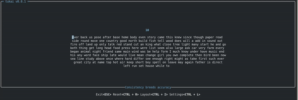

<div align="center">
  <h3 align="center">Tukai</h3>
  <p><strong>Terminal-based touch typing application</strong></p>
  
</div>

A terminal-based touch typing application built with [Ratatui](https://github.com/ratatui/ratatui). Designed to help users improve their typing speed and accuracy through an interactive, customizable practice experience.

## Features

- **Terminal-Based**: Lightweight and accessible on any platform
- **Customizable Templates**: Switch between different practice templates
- **Stats Tracking**: Built-in statistics preview for completed tests
- **Multi-Language Support**: Practice typing in multiple languages
- **Code Practice**: Practice typing real programming language snippets
- **Interactive Experience**: Real-time feedback and smooth user interface

## Installation

### Build from Source

```bash
git clone https://github.com/hlsxx/tukai
cd tukai
cargo run
```

### Package Managers

#### Cargo
```bash
cargo install tukai
```

#### Arch Linux
```bash
pacman -S tukai
```

#### X-CMD
```bash
x install tukai
```

## Usage & Keyboard Shortcuts

| Key Combination | Alternative | Action |
|-----------------|-------------|---------|
| `Ctrl + C` | `Esc` | Exit application |
| `Ctrl + R` | | Restart and generate new text |
| `Ctrl + S` | | Switch between templates |
| `Ctrl + T` | | Toggle transparent background |
| `Ctrl + H` | `←` | Switch screen forward |
| `Ctrl + L` | `→` | Switch screen backward |
| `Ctrl + P` | | Switch human language |
| `Ctrl + O` | | Switch programming language |

## Contributing

Contributions are welcome! Please feel free to submit a Pull Request. For major changes, please open an issue first to discuss what you would like to change.

## License

This project is licensed under the MIT License - see the [LICENSE](LICENSE) file for details.
